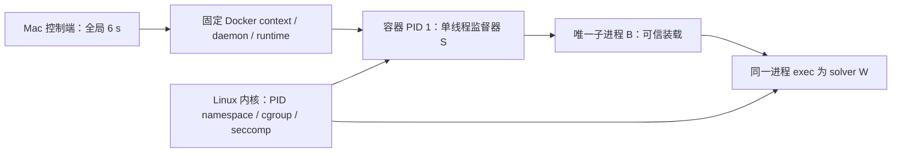

# E3 Linux 独立监督与资源设计

日期：2026-10-17。状态：随 [ADR 0029](../adr/0029-solver-linux-supervision-and-capabilities.md)接受，待具体实现与运行资格。用途：给出 B4 / B5 和新增 B6 装载问题的具体收口方案；读者为设计与验收者。不包含可运行 Docker 配方、真实工具接受、探针结果或公共观察 schema。

[ADR 0028](../adr/0028-bounded-solver-calibration-entry.md)的原容量、十二参数、输入输出、128 MiB、6 s 与内部 5 s / 1,000,000 steps 保持。E0 缺口始终阻断真实路径；当前只授权具体 ABI、内部传输格式、离线纯组件和模拟测试，不启动任何 Linux 程序。

## 拓扑与责任

S / B / W 属于一个私有 PID namespace、私有 cgroup namespace 与专用叶 cgroup；同一时刻最多 S 和 B/W 两个任务。S 必须是 PID 1，单线程，禁止 Docker init helper、健康检查、restart、exec 侧入口与额外监控进程。Mac / daemon / VM 仍在 ADR 0028 已披露的外部信任及资源范围；监督器没有额外的内存额度。

启动过程是 S → B → W；S 一直存活到捕获 / 回收完成。S 有 pidfd、timerfd、预打开的只读 cgroup 文件及私有控制 FD；W 只保留 stdin / stdout / stderr 三个 pipe FD，没有 cgroup、控制通道、listener 或载荷 FD。使用同一非 root UID，capabilities 全空、no-new-privileges；宿主管理员 / daemon / kernel 是可信前提，不声称能抵抗这些主体恶意修改进程。

Docker 外层策略允许 S / B 完成明确的设置步骤；子进程叠加更严格过滤器，不能由此取得 S 的权限。S 的阶段过滤器也只收紧。精确 syscall 及 FD 约束见[策略表](solver-linux-syscall-policy.md)，不采用 `seccomp=unconfined`、privileged、宿主挂载、设备或 Docker socket。

## B4：失联后的独立终止

### 时间起点与不可续期的 ARM

定义 Mac 连续计时的 `M0` 为首项 create 控制操作发出前，`DM=M0+6000 ms`。不以 attach、启动成功或求解开始重置计时。Mac 每次操作与成功判定都使用 DM。

1. S 进入自有代码后先建立 `CLOCK_BOOTTIME` timerfd，本地准备上限为进入时刻加 6,000 ms。此计时先于读取载荷 / 控制输入；所有等待和输出都受同一非阻塞循环约束。它只保证 Linux 持续运行条件下准备程序有限存活，不代表全局 6 秒已经满足。
2. S 固定本次 request / policy / image 绑定，核对 cgroup 后产生一次 READY。READY 含一次性挑战、Linux 时刻 `Lr`、boot / namespace 身份和配置摘要；不含任意可执行参数。此时没有 solver 子进程。
3. Mac 接收并核对 READY，在本地时刻 `Mr` 计算 `R=DM-Mr-δ`。`δ` 是资格记录中明确的计时换算 / 误差保守界；不得默认零或凭若干采样声称是数学保证。`R<=0`、换算溢出或无有效资格即取消。ARM 指定 `DL=Lr+R`、同一挑战 / request / policy，不接受“从收到 ARM 起再给 R”或续期。
4. S 仅接受一次完整 ARM，检查 `nowL<DL`，且 DL 不晚于本地准备上限。安装绝对 timerfd，并在同一 deadline 内收齐不超过 1 MiB 的 query、核对请求绑定的长度 / raw digest 后，才创建 B；过期、重复、错挑战、乱序或不完整消息直接退出。消息在传输中停留会消耗 DL，不扩展 solver 时间。
5. 本地成功只表示 W 退出、流完整和子进程已回收；Mac 仍须在 `nowM<DM` 时完成 runtime 确认与清理，才可进入 P4 正常路径。ARM 尚未建立时，迟到启动的 S 最多按本地准备限值退出，整个尝试已经失败；不得把这段回收称为 6 秒成功。

以上公式是基于 READY 的因果先后及已接受时钟误差界的设计推导，不直接相减两个系统的绝对时钟。Linux `CLOCK_BOOTTIME` 包含 Linux suspend 时间，但这不证明 OrbStack 虚拟时钟在 Mac 睡眠 / VM 暂停时的行为，也不会唤醒停止的 VM。[timerfd 文档](https://man7.org/linux/man-pages/man2/timerfd_create.2.html)

当前没有 δ 或虚拟时钟资格，不编造默认值。E4 必须区分“可接受的运行环境假设 / 误差范围”与“动态样本观察”；若无法为当前宿主明确这一范围，则 B4 仍阻断真实执行，而非把测量最大值包装成保证。跨主机暂停、boot / clock 身份变化使资格失效。

### S 的到期与异常路径

S 用 pidfd 标识唯一 B/W，避免用可复用的数字 PID 寻找另一进程。事件循环持续处理两流、控制输入、pidfd、timerfd 和装载通知；一次处理块有界，回到循环先检查 deadline，不做阻塞日志或无界排空。[pidfd_open](https://man7.org/linux/man-pages/man2/pidfd_open.2.html)、[pidfd_send_signal](https://man7.org/linux/man-pages/man2/pidfd_send_signal.2.html)

到期、控制 EOF、输出超限、传输错误或策略违规时：封闭正常发布 → 停止转发新 stdin → 向已绑定子进程发送 SIGKILL → 有界读取已取得的事实 → S 退出。到期后不等待第二个宽限窗口来争取正常成功；若 reap 无法及时完成，退出 PID 1 触发内核 namespace 收束。不能把 timerfd 到期时刻等同于内核已完成回收时刻。

PID 1 异常死亡也会使内核终止 namespace 内其余进程；因此监督器自己被 OOM 杀死不会留下一个故意脱离监督的 W。该机制依赖进程不逃出 namespace / cgroup；B 只创建一次且 W 的 clone / fork / setns / unshare 等全部禁止。[PID namespace 文档](https://man7.org/linux/man-pages/man7/pid_namespaces.7.html)

| 故障 | 独立动作 / 结论 |
| --- | --- |
| Mac CLI 退出、网络断开、daemon 不响应，但 Linux 任务可调度 | S 的已装载绝对 timer 不续期；不依赖 daemon 发 kill，检测控制 EOF 时提前失败 |
| ARM 丢失或迟到 | 无 W；S 准备定时退出。可能晚于全局窗口，只能记录失败 / 未确认清理 |
| S 崩溃 / 被杀 | PID 1 退出触发 namespace 杀死其余任务；丢失的最终流 / OOM 事实保留 unknown |
| W 忽略普通信号、无限计算或堵塞输出 | W 不能阻塞 S 的非阻塞事件循环；SIGKILL 与 PID 1 退出是终止路径，不依赖 W 合作 |
| Linux 内核卡死、不可中断等待、VM 冻结或 Mac 睡眠 | 不承诺 6 秒物理回收；执行资格不适用于该状态，恢复后只核对精确容器，不续跑 / 重试 |
| 无法取得最终状态或删除确认 | 失败并保持当前目标锁定，禁止下一次 attempt；不能用 daemon 不可达或容器查不到推导已清理 |

## B5：cgroup 观测、OOM 与空树

### 能力矩阵

runtime 配置是意图，S 的只读读回是生效事实，外层最终状态是事后确认。三者必须绑定同一 daemon、container ID、PID / cgroup namespace 和时间线。

| 项目 | 固定要求 / 来源 | 不允许的替代 |
| --- | --- | --- |
| cgroup | v2，私有 cgroup namespace，S 位于容器专用叶 cgroup；从 runtime 提供的只读 cgroupfs 获取本容器视图 | 把 namespace 根当作整个 VM 根；按宿主目录猜路径 |
| memory | `memory.max=134217728`、`memory.swap.max=0`；读回前后均一致 | 只查 Docker HostConfig、采样 RSS、增加 swap |
| tasks | `pids.max=2`；执行前仅 S，执行时 S+B/W，W 无线程 / 后代权限；pids.current 与可见成员匹配，0 / 不可见成员或额外任务拒绝 | 提高 pids 为 libc 线程让路、忽略额外 PID |
| 事件 | 预打开并读取 `memory.events.local`、`memory.events`、`memory.current`、`memory.peak`、`pids.current`、`pids.events`、`cgroup.events` / `cgroup.procs` | 写入清零、推测不存在字段为 0 |
| cgroup 写权限 | 无；`cgroup.kill` 不进入 S 的必需能力 | 为 kill 或读回挂载宿主 cgroup、启用 privileged / CAP_SYS_ADMIN |
| rootfs / mounts | 只读 scratch 载荷与 bootstrap；允许 runtime 的隔离内核伪文件系统，仅 S/B 做固定读取 | host bind / volume / device / credential；给 W 开放这些读取 |

Docker v2 的默认 cgroup namespace 是 private，但默认值不是本项目验收结果；必须明确配置并读回。只读容器 cgroup 视图不等同于用户提供的宿主 bind mount；当前非 root 身份若不能读取必需字段，直接阻断，不改权限。[Docker runtime metrics](https://docs.docker.com/engine/containers/runmetrics/)

`memory.max` 保持内核暂时超额语义；`memory.events` 可累计子层级事件，local 只看本层。`oom_kill` 计数本 cgroup 中被各种 OOM killer 杀死的进程，单凭它不能证明一定是本次 128 MiB 上限触发。`memory.oom.group` 只读记录，不要求写 1；不修改 oom_score_adj 保护监督器、不关闭 OOM killer。[cgroup v2 文档](https://docs.kernel.org/admin-guide/cgroup-v2.html)

CLI 原文件页、sealed memfd、S/B 的堆栈、query、捕获队列与 W 都计入该 cgroup；共享页按内核收费，不把双映射简单算成两份，也不假设必然能装进 128 MiB。Docker 设置 memory+swap 等于 memory 只是配置表达，最终仍要求实际 swap.max 为零。[Docker 资源文档](https://docs.docker.com/engine/containers/resource_constraints/)

### OOM 归因

记录全新容器的基线、后续事件增量和各次读取区间；同一 namespace 内无其他作业、无 cgroup 迁移。只有取得关联的本地 `oom` / `max` / `oom_kill` 观察并能与子进程状态对上，才报告可归因的 memory 失败。联合计数也不能证明不存在同时发生的全局内存压力；存在歧义时仍保留原因未定。只有 exit 137、SIGKILL、Docker OOMKilled 或单独的 oom_kill 增量时，保留各项原始事实与不确定性，不猜成“本地内存限额已验证”。

S 被 OOM 杀死或控制通道丢失时，可能无法取得最后一次计数；缺失即缺失。E4 必须覆盖此分支，但不得要求缺失事实自动补成成功。事件计数没有精确发生时间；真实记录需保存观测时间 / 区间，不能直接复用 E1 模拟 `at_ms` 冒充内核事件时间。OOM / deadline 先后无法区分时保留 `order-unresolved`，不把检测次序说成因果次序；失败路径不发布正常 P4 响应，真实格式另行闭合。

### 空树确认

S 存活时 `cgroup.events populated=1` 是正常事实，不能从内部读到“整个 cgroup 已空”。正常收尾分三步：

1. S 用 waitid / pidfd 确认唯一子进程退出，收齐 EOF，核对 tasks / cgroup.procs 只剩 S，再发送绑定的终态摘要并自行退出。
2. Mac 经同一已验收 runtime 确认容器 init 已退出、Running=false / Pid=0、无重启；将 Linux PID namespace init 退出语义与该 runtime 的隔离 / 回收资格共同作为整树终止依据，明确标记 `pidns-init-exit-and-runtime-state`，不声称读取了事后 populated=0。
3. 在原 DM 内完成精确 ID 的删除及后置确认；未确认、收到互相矛盾的状态、超时或 S 终态缺失，均不发布正常响应。Docker remove 或查无容器单独都不是空树证据。

这是 ADR 0029 D2 已接受的内核 / runtime 信任前提，仍需负向资格验证。若要求每次都直接读取退出后 cgroup 为空，而当前只读容器接口做不到，本方案停止；不增加 Linux host broker 或宿主 cgroup 挂载来悄悄满足它。

## B6：固定装载与阶段封闭

S 打开镜像中的唯一 CLI，核对实际 digest，用固定 `MFD_CLOEXEC|MFD_ALLOW_SEALING|MFD_EXEC` 创建对象、写入 bytes，确认 `F_SEAL_WRITE|F_SEAL_GROW|F_SEAL_SHRINK|F_SEAL_SEAL`；禁止 scripts / PT_INTERP，只接受已登记静态 AArch64 ELF。执行用同一 sealed 对象，FD 设 CLOEXEC。内核不支持 MFD_EXEC 或层级 vm.memfd_noexec 策略拒绝执行对象时停止，不改 sysctl、去掉 flags 或退回路径 exec。[可执行 memfd 策略](https://docs.kernel.org/userspace-api/mfd_noexec.html)、[memfd 文档](https://man7.org/linux/man-pages/man2/memfd_create.2.html)

B 是 S 单次 fork 的可信分支：无 CLONE_VM、无其他线程，阻塞信号且无用户信号处理器；不读 solver stdin、不解释模型或运行第三方代码。S 在 fork 前准备固定 argv、空 envp、空路径常量与所有 FD，B 只做已审阅的 dup / close、过滤器安装、listener 交付和固定 execveat。所有初次调用参数的存储与生命周期属于 bootstrap TCB。

B 的最终 seccomp 对 `execveat` 只返回 USER_NOTIF，不直接 ALLOW；`execve` 永久禁止。listener 经私有 AF_UNIX socketpair / SCM_RIGHTS 单次交给 S，B 关闭该 socket 和 listener，再发固定 execveat。S 核对通知 ID、自己创建的唯一 child、AArch64 ABI、固定 fd / flags 与可信 fork 前准备的参数指针，只在 `awaiting-trusted-first-exec` 状态且重新读取的 BOOTTIME 仍小于 DL 时处理；创建 B 前也必须重新检查 DL。**先不可逆消费一次性状态，再发一次 CONTINUE**。发送失败也不重试。用户态检查与 syscall 之间仍可能被调度暂停，因此不把这个检查声称为物理实时原子门；实际完成超出全局 DM 的路径始终失败。

这里不读取或解释子进程 pathname，不把“读取后相同”当成无竞态证明。保证依赖首次调用之前仍全部是已接受的可信 bootstrap、没有能并发改参的主体。任何需要读不可信内存才能作出的放行决定都超出该方案。进入 W 后的 execveat 通知无条件拒绝并终止本次尝试；S 不存在再次 CONTINUE、ADDFD 或代执行系统调用的分支。S 死亡由 PID namespace 收束，listener 丢失也不能成为放行。[USER_NOTIF 风险与接口](https://man7.org/linux/man-pages/man2/seccomp_unotify.2.html)

该方案增加了必须审查的阶段不变量，不是用 USER_NOTIF 替代安全边界。若可信首次阶段无法通过源码 / ABI 审查建立，或者实际过滤器组合可能绕过通知，则 B6 保持阻断；不以测试几个路径就宣称证明。

## 传输、实现接口与 ABI 审阅

S 捕获 W 的两根 pipe，而 Docker stdout 是 S 的有界内部封套，不能直接送入 P4。拟议 `bootstrap-control-v0.1` 分别承载 READY / ARM / 子进程事件、stdout / stderr chunk 与 EOF；类型化解封套后原 solver bytes 原样接既有 P4。Docker CLI 的独立通道不能再次按 Engine 八字节头解码；E1–E2 模拟类型保持 simulation，不把它们直接重标真实 capture。

封套的完整字段 / 编码、固定 header 和长度检查由后续纯实现规格闭合：单 frame payload 不超过 65,536 bytes，控制累计不超过 65,536，待发送队列不超过 131,072；solver 两流仍分别是 4,194,304 / 65,536，query 仍为 1,048,576。这些是新增本地诊断收紧项，均计入原内存；任何溢出停止。外层 stdin 的查询结束帧只关闭 W stdin，不结束 S 的控制生命周期；外层通道 EOF 视为失联。不得让下游不读取造成 S 永久阻塞。

| ABI / unsafe 面 | 必须证明的局部不变量 | 失败处理 |
| --- | --- | --- |
| fork / pidfd / waitid | 单线程可信父进程；仅一子进程；不通过 PID 重用绑定其他任务；EINTR 不重新创建 | 终止并保留真实错误 |
| timerfd / poll | BOOTTIME 绝对时刻、checked 换算、有界队列；每次循环先处理截止；不使用阻塞输出 | 不续期、不转正常结果 |
| memfd / seals / execveat | 完整字节、密封集合、同一 FD、CLOEXEC、空 envp；所有指针在 syscall 期间有效 | 禁止路径 fallback |
| seccomp / BPF / notification | 固定 audit arch、32/64 位参数比较；内核结构尺寸先校验再分配；状态先消费、只一次 CONTINUE；不允许过滤器替换 | 拒绝整个资格或尝试 |
| FD / ancillary data | SCM_RIGHTS 数量恰一、MSG_CTRUNC 拒绝、FD 不重复关闭；child 最终仅 0/1/2；S 不把其控制 FD 交给 W | 清理已拥有 FD 后失败 |
| cgroup / proc 只读解析 | 固定自有视图、受限 bytes / entries、拒绝缺失 / 重复关键字段与身份漂移；不跟随任意路径 | 资格失败，无权限修复 |

拟在独立 Linux bootstrap crate 中审查以上 FFI；不在 axiom-ir 或现有 simulation crate 添加 unsafe、OS 执行或依赖。具体 libc / syscall 绑定、工具版本和源码许可尚需实施前清单，不在本次手写 syscall 编号或安装工具。

## E4 资格矩阵与本次结束条件

后续每项先固定自有探针源码 / 预期 / image / policy / 输入，再取得授权；当前全部未执行。

| 组 | 必须覆盖的反例 | 合格条件 |
| --- | --- | --- |
| T：时间 | READY / ARM 延迟重放、启动晚于 DM、不同 clock / boot、Mac 中断、daemon 断连、输出背压、准备阻塞 | W 不在过期 ARM 后启动；失联无需新 Docker 命令触发本地终止；晚回收永不成功 |
| P：进程 | S 被杀、W 忽略信号、第二次 clone / thread、PID namespace 逃逸、非空尾链 | 两任务边界、唯一 child、父死收束及 runtime 最终状态一致 |
| M：cgroup | memory/swap/pids 错配、读回缺失、W OOM、S OOM、全局 OOM 歧义、事件晚到 | 缺失不补零；归因有据，未知保留；不写宿主配置 |
| X：装载 | CLI 换字节、seal 缺失、绝对 pathname、第二次 exec、通知重放 / ID 失效、listener 丢失、过滤器叠加 | 初次可信对象唯一；W 无再次执行路径；安全性不靠读取不可信 pathname |
| S：syscall | 文件 / 网络 / 新 FD、线程、namespace、权限、ptrace、BPF / io_uring、未知 arch / syscall | 精确静态策略拒绝，不能根据探针结果自动扩表 |
| O：观察 | 流恰等 / 差一、控制混流、丢 EOF、S 终态丢失、remove 成功但无退出事实 | 原字节保持，缺失与矛盾失败；无正常候选发布 |

B4 / B5 已从模糊要求落实为提案、信任前提和可否决矩阵；B6 是本次静态审阅新增的显式门禁。当前没有运行资格或可执行制品。D1–D3 已接受；下一步完成具体 ABI / 内部传输格式与纯组件，同时保留 E0 与实际运行资格门禁；不把设计文档完成等同于真实执行门禁通过。
